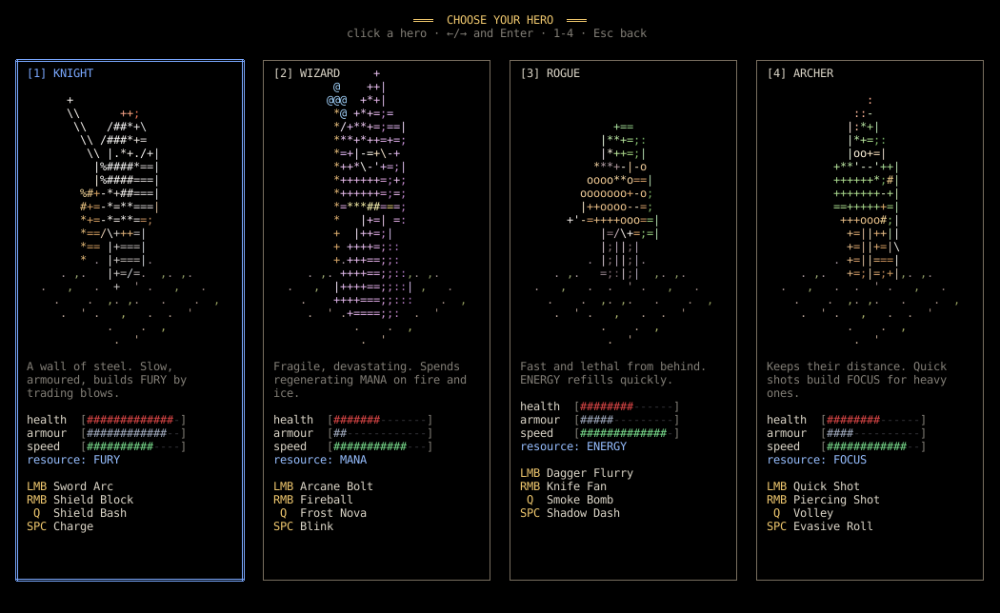
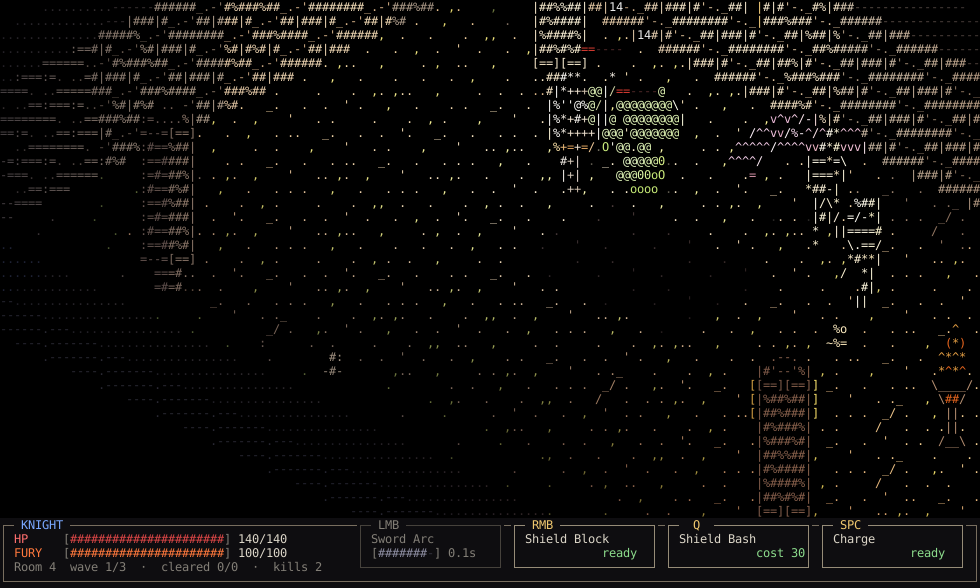

# glyphcrawl

An isometric, real-time ASCII dungeon crawler. The dungeon is hand-drawn ASCII art; the heroes
and monsters are **live 3D figures built from primitives** (boxes, spheres, cylinders, cones,
octahedra) that are raycast on the CPU and turned into characters by an "ASCII shader".
It runs in your **terminal** or in its own **window**.




Pick one of four heroes — Knight, Wizard, Rogue, Archer — and fight through a generated crypt:
rooms seal shut, waves of skeletons, archers, slimes and bats pour in, every cleared room offers
one of three upgrades, and the Bone Golem waits at the end. One life per run.

## Run it

```bash
cargo run --release                  # in this terminal
cargo run --release -- --window      # in a native window (mouse wheel = zoom)
```

Best terminals: **Ghostty** or **kitty** (they report key releases, so WASD movement works).
WezTerm needs `enable_kitty_keyboard = true` in its config. Other terminals (and tmux) still work
in *mouse mode*: click to move, keys for skills.

The game needs at least **120×36** cells. Zoom is your font size: in a terminal use its font
shortcut (Ctrl+- / Ctrl+=) and the game redraws for the new size; in the window, use the wheel.

### Sound

Sound is generated in code (no sample files), but the audio backend needs ALSA headers:

```bash
sudo apt install libasound2-dev pkg-config
cargo run --release --features audio
```

## Controls

| Input | Action |
|---|---|
| Left click | walk there / attack the enemy under the cursor (hold to keep going) |
| Right click (or E) | special — hold to block (Knight) or draw the bow (Archer) |
| Q | skill |
| Space | mobility: charge / blink / shadow dash / roll |
| W A S D | move; while moving, left click attacks towards the cursor |
| 1 2 3 4 | the four abilities from the keyboard |
| Esc | pause |
| F1 | debug overlay (fps, render time, bytes per frame) |
| F5 | reload everything in `assets/` |
| F2 / F3 / F4 | dev: reveal map / god mode / kill all enemies |

## Command line

```text
--window            native window instead of the terminal
--class NAME        skip the menus: knight, wizard, rogue, archer
--room NAME         play a single room template (e.g. test, test_boss)
--seed N            dungeon seed
--god               the hero can't die
--screen NAME       menu, classes, game, gallery, sandbox
--focus NAME        gallery: start on this figure or stamp
--mouse-only        ignore key-release support
--headless          no screen: run N --frames and print timings
--bot               let the autoplayer drive (great with --headless)
--dump / --png F    headless: print the last frame as text / save it as a PNG
```

Examples:

```bash
cargo run --release -- --screen gallery                     # browse figures and stamps
cargo run --release -- --class rogue --room test_boss       # straight to the boss
cargo run --release -- --headless --bot --class archer --frames 20000 --god
```

## Making art and content

Everything lives in `assets/` as text. Press **F5** in game (or in the Gallery) to reload.

- **`stamps/*.stamp`** — the dungeon pieces. A stamp is a glyph grid plus a colour-key grid.
  Its `proxy` line gives it a 3D box (`x0 z0 x1 z1 height_rows`) or `floor`; from that every cell
  gets a height and a facing, which drives lighting and lets figures walk *behind* walls.
  Floor tiles are 16×4 diamonds; full walls are 10 rows tall, "stumps" (walls nearest the
  camera, drawn short so they don't hide the action) are 3 rows.
- **`tileset.ron`** — which stamps draw which tile; `"floor_a*10"` gives a variant a weight.
- **`materials.ron`** — colours and glyph ramps (dark → bright) for stamps and figures.
- **`figures/*.ron`** — 3D figures: parts with a shape, size, pivot and parent, plus animation
  clips made of keyframes (`Keys`) and oscillators (`Osc`). `+x` is forward, `+y` up; rotation
  `z` swings a limb forward/back.
- **`rooms/*.room`** — room templates: `#` wall, `.` floor, `D` door slot (on the edge),
  `~` pit, `+` pillar, `s` enemy spawn, `t` brazier, `T` wall torch, `@` start, `B` boss,
  `c` shrine chest. The generator chains rooms through their door slots.
- **`classes.ron`, `abilities.ron`, `enemies.ron`, `upgrades.ron`** — all game balance.
- **`shader.ron`** — ASCII shader tuning (when to draw outlines vs. shaded fill).
- **`glyph_dim.ron`** — how glyphs fade in the dark (`# → = → - → .`).

## How it works

```
src/game/      the simulation — pure, deterministic, no I/O (checked by a test)
src/render/    iso projection, stamps + lighting, figure raycaster, ASCII shader, effects, UI
src/platform/  terminal (crossterm), window (minifb + fontdue), headless, audio (kira)
src/app/       main loop, screens (menus, game, gallery), settings, bot
```

- **Projection.** `col = 8(x − z)`, `row = 2(x + z) − 2√6·y` (2:1 dimetric with cells twice as
  tall as wide). At a fixed screen position a higher surface is nearer the camera, so the
  depth buffer is just a *height* buffer — which is why per-cell stamp heights can hide 3D
  figures correctly.
- **Figures.** Each cell gets 2×4 square samples. Rays (all parallel: orthographic camera) are
  intersected exactly with each part's primitive in its local space.
- **ASCII shader.** Samples behind dungeon geometry become an x-ray outline; cells where a
  silhouette or depth jump runs through get a directional glyph (`' - . _ / \ |`); everything
  else gets a glyph from its material's ramp by how brightly it's lit.
- **Terminal output.** Only changed cells are sent, colours only when they change, wrapped in
  synchronized-update markers; the frame rate adapts (60 → 45 → 30) if the terminal can't keep up.

## Tests

```bash
cargo test
```

Includes: level generation over 300 seeds (connectivity, no overlaps, start/boss placement),
determinism (same seed + inputs → same world), field-of-view symmetry, combat maths, the
terminal diff encoder, an "is `game/` still pure" check, and snapshot tests of the ASCII shader
(review changes with `cargo insta review`).

## Credits

Font: DejaVu Sans Mono (`assets/fonts/DejaVu-LICENSE.txt`). Sound is synthesised in code.
